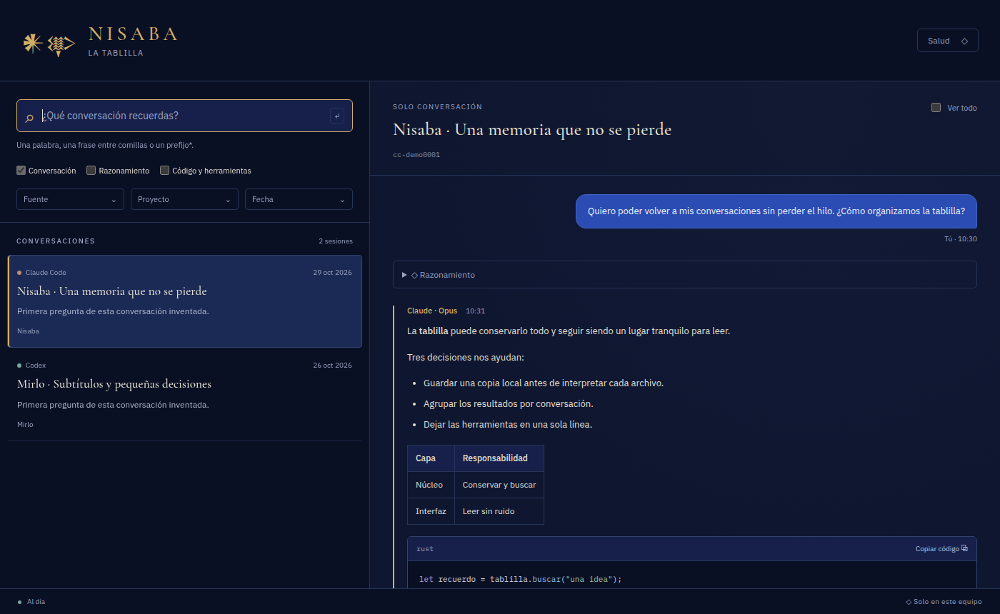

<div align="center">


**La bóveda local de tus conversaciones con IAs.**
Encuentra por palabra o frase lo que hablaste con Claude Code o Codex, y reléelo sin ruido.

[English](README-EN.md) · Licencia [GPL-3.0](LICENSE) · v0.1.0

> ⚠️ **Prerelease.** Funciona y se usa a diario, pero aún no es estable: pueden cambiar comandos y formatos.



</div>

## ¿Por qué este proyecto?

Trabajo a diario con varias IAs. Lo que aprendí y decidí con ellas queda repartido en formatos y carpetas distintas, y una parte se pierde: **Claude Code borra por defecto las sesiones de más de 30 días**. Cuando quiero volver a "aquella conversación donde resolvimos X", acabo haciendo `grep` sobre archivos JSON ilegibles o me rindo.

Nisaba lee las sesiones que esas herramientas ya guardan en tu disco, las indexa y te deja **buscarlas y releerlas bien presentadas**: tus mensajes, las respuestas, el código y el Markdown, sin muros de llamadas a herramientas. Si una fuente borra una sesión, la tablilla la conserva: **la tablilla solo crece**.

El nombre viene de Nisaba, la diosa sumeria de la escritura y de los escribas. La bóveda se llama "la tablilla".

## Qué hace hoy (v0.1)

- **Fuentes:** Claude Code (`~/.claude/projects`) y Codex (`~/.codex`).
- **Búsqueda** por palabra, frase entre comillas o prefijo (`medica*`), con filtros de fuente, proyecto y fecha.
- **Lector "solo conversación":** las herramientas se resumen en una línea y el razonamiento queda plegado. Con "Ver todo" se muestra cada evento.
- **Panel de salud:** archivos vistos frente a parseados por fuente, para que nunca falte nada sin que lo sepas.
- **Tres puertas:** la ventana, la terminal (`nisaba`) y tus IAs vía **MCP**.
- **Sin red:** nada sale de tu equipo.

## Instalación

Descarga el archivo de tu sistema desde [Releases](https://github.com/D4vRAM369/Nisaba/releases). Todos los paquetes incluyen la ventana (`nisaba-gui`) **y** la terminal (`nisaba`).

> Mientras el repositorio sea privado, solo quien tenga acceso a él puede ver y descargar la release.

### Linux

| Formato | Instalar |
|---|---|
| `.deb` (Debian, Ubuntu, Mint…) | `sudo apt install ./Nisaba_0.1.0_amd64.deb` |
| `.rpm` (Fedora, openSUSE…) | `sudo dnf install ./Nisaba-0.1.0-1.x86_64.rpm` |
| AppImage (portable, sin instalar) | `chmod +x Nisaba_0.1.0_amd64.AppImage && ./Nisaba_0.1.0_amd64.AppImage` |
| Flatpak | `flatpak install --user ./Nisaba_0.1.0_x86_64.flatpak` (necesita el runtime `org.gnome.Platform//50` de Flathub) |

El Flatpak solo puede **leer** `~/.claude` y `~/.codex`, y no tiene acceso a la red.

### Windows 10/11

| Formato | Instalar |
|---|---|
| Instalador (`Nisaba_0.1.0_x64-setup.exe`) | Doble clic. Añade `nisaba` al `Path` de tu usuario. |
| `.msi` | Doble clic (pensado para despliegues gestionados). |
| Portable (`Nisaba_0.1.0_x64_portable.zip`) | Descomprime y abre `nisaba-gui.exe`. El índice se guarda en `datos\`, junto al `.exe`. |

Los binarios aún no están firmados, así que Windows mostrará **"Windows protegió su PC"**. Pulsa **Más información → Ejecutar de todas formas**.

## ¿Cómo usarlo?

### En la ventana

1. Abre **Nisaba**. La primera vez indexa tus sesiones (unos 30 s para ~700 conversaciones); mientras tanto ya puedes buscar.
2. Escribe en el buscador: busca mientras escribes. Usa `"una frase exacta"` o un prefijo como `medica*`.
3. Afina con **Fuente**, **Proyecto** y **Fecha**, o marca **Razonamiento** / **Código y herramientas** para buscar también ahí.
4. Pulsa un resultado: el lector salta a la coincidencia. **Ver todo** muestra cada herramienta y cada evento.
5. **Salud** (arriba a la derecha) indica si cada fuente está completa.

### En la terminal

```bash
nisaba buscar "frase o palabra"
nisaba buscar "medica*" --fuente codex --proyecto Mirlo --desde 2026-10-01 --limite 20
nisaba buscar "algo" --json            # salida para scripts
nisaba ver cx-xxxxxxxx                  # el id lo imprime `buscar`
nisaba ver cx-xxxxxxxx --todo           # con herramientas, razonamiento y ocultos
nisaba abrir cx-xxxxxxxx                # abre esa conversación en la ventana
nisaba salud                            # estado de cada fuente
nisaba uso                              # búsquedas por día y canal
```

En Flatpak, antepón `flatpak run --command=nisaba io.github.d4vram369.Nisaba` (por ejemplo, `flatpak run --command=nisaba io.github.d4vram369.Nisaba buscar "algo"`).

### Desde tu IA (MCP)

Nisaba incluye un servidor MCP que solo habla por `stdio` (no abre puertos). Para que Claude Code pueda buscar en tu historial:

```bash
claude mcp add --scope user nisaba -- nisaba mcp
```

Con Flatpak:

```bash
claude mcp add --scope user nisaba -- flatpak run --command=nisaba io.github.d4vram369.Nisaba mcp
```

Después, en una sesión nueva, pídele algo como *"busca en mis conversaciones dónde decidimos usar FTS5"*.

### Carpetas y variables

| Qué | Por defecto | Variable para cambiarlo |
|---|---|---|
| Índice (la tablilla) | Linux: `~/.local/share/nisaba` · Windows: `%APPDATA%\nisaba` · Portable: `datos\` junto al `.exe` | `NISABA_HOME` |
| Sesiones de Claude Code | `~/.claude/projects` | `NISABA_CLAUDE_DIR` |
| Sesiones de Codex | `~/.codex` | `NISABA_CODEX_DIR` |
| Ajustes de Claude Code (aviso de limpieza) | `~/.claude/settings.json` | `NISABA_CLAUDE_SETTINGS` |

## Privacidad

- **Sin red, sin cuentas, sin telemetría.** Ni las fuentes tipográficas se descargan.
- Nisaba **solo lee** las carpetas de Claude Code y Codex; nunca escribe en ellas.
- El contador de uso (`nisaba uso`) vive en tu índice y nunca sale del equipo.

## Hoja de ruta

| Versión | Contenido |
|---|---|
| **v0.1** | Claude Code + Codex, CLI, MCP, ventana, panel de salud |
| v0.2 | OpenCode |
| v0.3 | Pi |
| v0.4 | Gemini CLI |
| v0.5 | Antigravity (parcial) |
| v0.6 | Exportaciones ZIP de ChatGPT y Claude.ai |
| v0.7 | Tema claro "Arcilla", barra lateral, atajo global, inglés en la interfaz, aviso de secretos, exportar a Markdown |
| v1.0 | Todo lo anterior, estable |

## Compilar desde las fuentes

```bash
cargo test --workspace
npm --prefix crates/nisaba-gui/ui ci
npm --prefix crates/nisaba-gui/ui run tauri -- dev
```

## Licencia

[GPL-3.0-or-later](LICENSE) © 2026 D4vRAM369.
